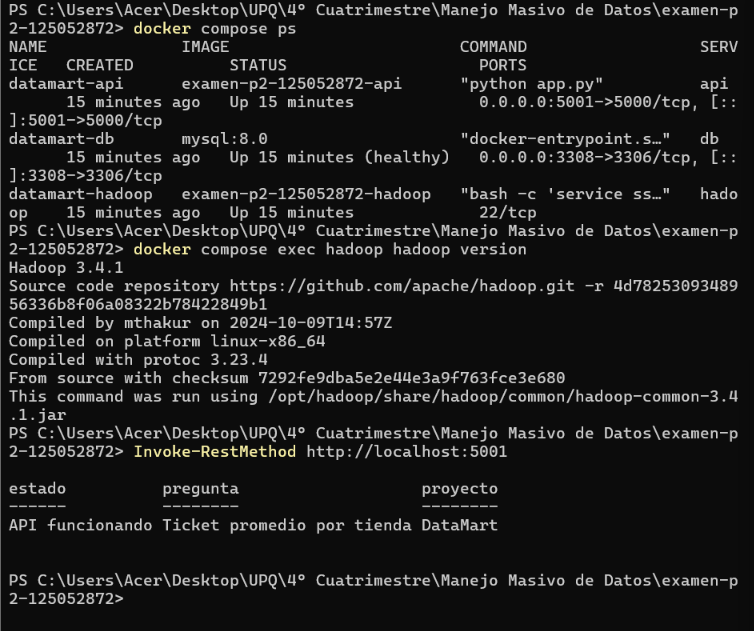
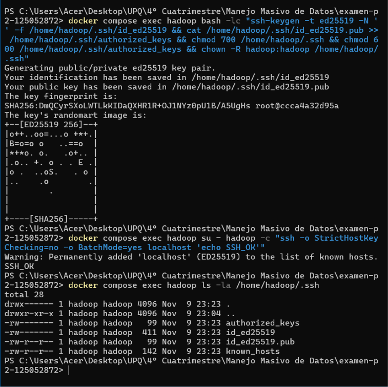
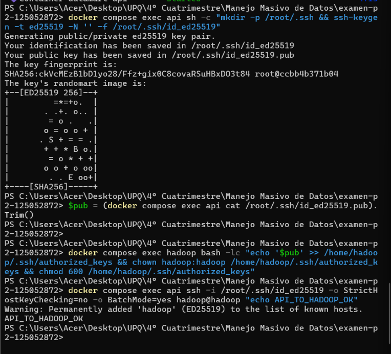
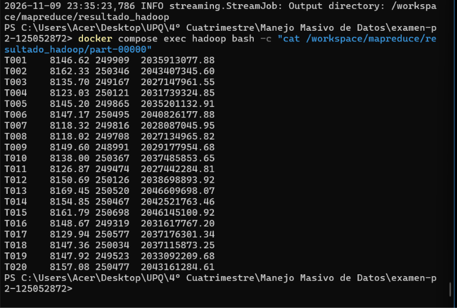
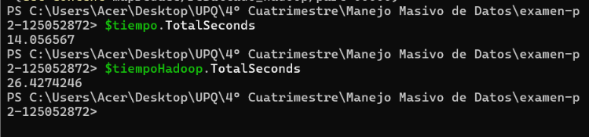
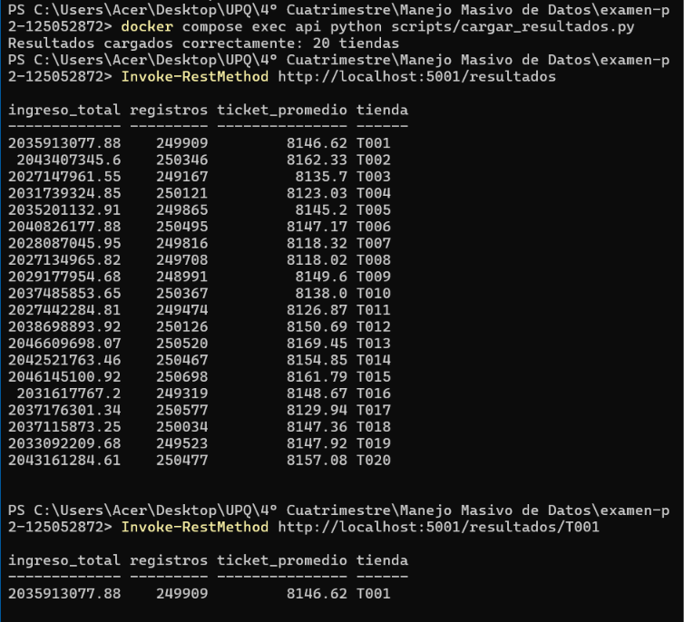
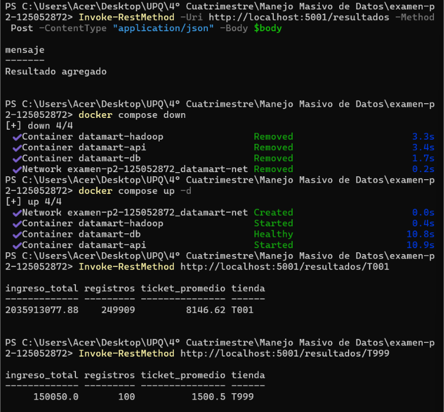
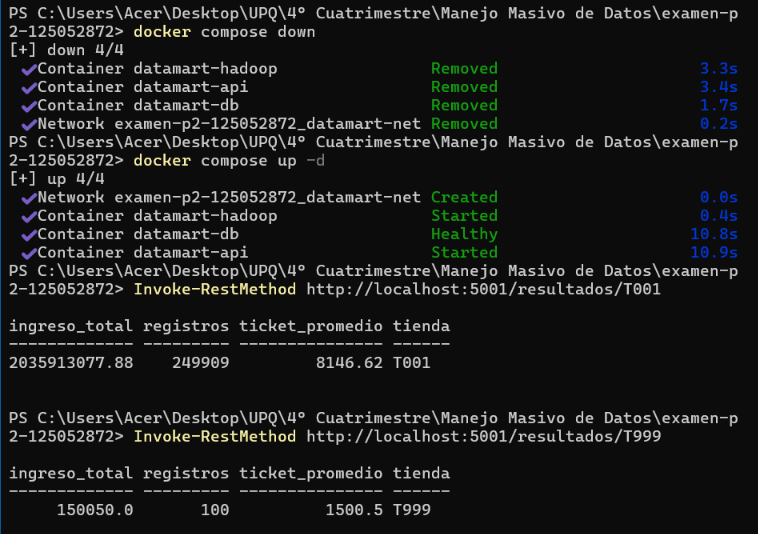

# EXAMEN SEGUNDO PARCIAL - CAROLINA HDZ GÓMEZ
# IDIA224
## Pipeline de datos contenerizado

### Datos generales

- **Materia:** Manejo Masivo de Datos
- **Docente:** José Javier Moya Moya
- **Matrícula:** 125052872
- **Dataset:** ventas_125052872.csv
- **Registros generados:** 5,000,000
- **Pregunta de negocio:** Ticket promedio por tienda

### Objetivo

Desarrollar un pipeline de datos contenerizado que permita procesar registros de ventas mediante Hadoop MapReduce, almacenar los resultados en una base de datos MySQL y consultarlos a través de una API desarrollada con Flask

---

# PARTE A. INFRAESTRUCTURA CON DOCKER

### A1. Dockerfile de Hadoop

Se creó un Dockerfile utilizando Debian Bookworm como imagen base, instalando Java OpenJDK 17, Python 3 y Hadoop 3.4.1 en modo standalone, además se configuraron las variables JAVA_HOME, HADOOP_HOME y PATH para permitir la ejecución de los comandos correspondientes

La instalación se verificó mediante el comando:

```bash
/opt/hadoop/bin/hadoop version
```

### A2. Docker Compose

Se configuró el archivo docker-compose.yml con tres servicios principales

- **Hadoop:** encargado del procesamiento de los registros mediante MapReduce
- **MySQL:** utilizado para almacenar los resultados obtenidos y conservarlos mediante un volumen nombrado
- **API:** desarrollada con Flask para consultar y modificar la información almacenada

Los servicios se conectaron mediante una red definida en Docker Compose, además, se utilizaron variables de entorno para configurar las credenciales de MySQL y depends_on para establecer la dependencia de la API respecto a la base de datos

El proyecto se levanta mediante:

```bash
docker compose up --build -d
```

### Generación del dataset

Se utilizó el archivo generar_dataset.py para crear un conjunto de datos personalizado a partir de la matrícula, generando 5 millones de registros de ventas con información de fechas, tiendas, categorías, productos, cantidades, precios y métodos de pago

Comando utilizado:

```bash
python generar_dataset.py 125052872
```

El archivo generado fue ventas_125052872.csv, con un tamaño aproximado de 336 MB, el cual se montó en el contenedor Hadoop como volumen de solo lectura y se excluyó del repositorio mediante .gitignore

---



# PARTE B. CONFIGURACIÓN SSH

Se configuró OpenSSH Server dentro del contenedor Hadoop y se generaron llaves de autenticación para permitir conexiones sin contraseña, posteriormente se agregó la llave pública al archivo authorized_keys para autorizar el acceso

Se realizaron dos pruebas de conexión

**1. Conexión local desde Hadoop**

```bash
ssh localhost
```

Resultado obtenido:

```text
SSH_OK
```

**2. Conexión desde el contenedor API hacia Hadoop**

```bash
ssh hadoop@hadoop
```

Resultado obtenido:

```text
API_TO_HADOOP_OK
```

Ambas pruebas permitieron comprobar que las conexiones SSH funcionaron correctamente sin solicitar contraseña

---





# PARTE C. PROCESAMIENTO CON MAPREDUCE

### C1. Procesamiento con Hadoop Streaming

De acuerdo con el último dígito de la matrícula, se asignó la pregunta de negocio correspondiente al cálculo del ticket promedio por tienda

Para obtener este resultado se utilizó la siguiente operación

**Ticket promedio = Ingreso total / Número de registros**

El ingreso total se obtiene multiplicando la cantidad vendida por el precio unitario y sumando los ingresos correspondientes a cada tienda

Se desarrollaron dos archivos principales

- **mapper.py:** lee los registros del CSV, ignora el encabezado, identifica la tienda y calcula el ingreso de cada venta
- **reducer.py:** agrupa los ingresos por tienda, suma los registros y obtiene el ticket promedio

El procesamiento se ejecutó mediante Hadoop Streaming, utilizando el siguiente comando

```bash
docker compose exec hadoop bash -c "rm -rf /workspace/mapreduce/resultado_hadoop && /opt/hadoop/bin/hadoop jar /opt/hadoop/share/hadoop/tools/lib/hadoop-streaming-3.4.1.jar -D mapreduce.framework.name=local -D fs.defaultFS=file:/// -D mapreduce.job.reduces=1 -input /data/input/ventas_125052872.csv -output /workspace/mapreduce/resultado_hadoop -mapper 'python3 mapper.py' -reducer 'python3 reducer.py' -file /workspace/mapreduce/mapper.py -file /workspace/mapreduce/reducer.py"
```

El trabajo terminó correctamente y generó resultados para las 20 tiendas identificadas en el dataset

### Resultados obtenidos

La salida del procesamiento contiene el identificador de la tienda, el ticket promedio, el número de registros y el ingreso total

### C2. Comparación de rendimiento

Para comparar el rendimiento se creó el archivo secuencial.py, el cual realiza la misma operación utilizando Python sin Hadoop, posteriormente se midieron los tiempos de ejecución de ambos métodos

| Procesamiento | Tiempo obtenido |
|---|---:|
| Python secuencial | 14.06 segundos |
| Hadoop MapReduce | 26.43 segundos |

Los resultados obtenidos mediante ambos métodos coincidieron, sin embargo, Python secuencial terminó en menos tiempo, debido a que Hadoop necesita realizar procesos adicionales para iniciar y organizar el procesamiento, por lo que en este caso el método secuencial resultó más rápido para el tamaño del archivo utilizado

---





# PARTE D. INTEGRACIÓN CON MYSQL Y API

### Carga de resultados

Se desarrolló el archivo cargar_resultados.py para leer la salida generada por Hadoop Streaming e insertar los registros en una tabla de MySQL llamada resultados

La tabla contiene los siguientes campos

- tienda
- ticket_promedio
- registros
- ingreso_total

La carga se realizó mediante el comando

```bash
docker compose exec api python scripts/cargar_resultados.py
```

Como resultado se insertaron correctamente los datos correspondientes a las 20 tiendas

### Desarrollo de la API

Se utilizó Flask para crear una API conectada a MySQL, permitiendo consultar y modificar los resultados obtenidos durante el procesamiento

Los endpoints implementados fueron

| Método | Endpoint | Función |
|---|---|---|
| GET | /resultados | Consultar todos los resultados |
| GET | /resultados/<tienda> | Consultar una tienda específica |
| POST | /resultados | Agregar un nuevo registro |
| PUT | /resultados/<tienda> | Actualizar un registro |
| DELETE | /resultados/<tienda> | Eliminar un registro |

### Pruebas de funcionamiento

Se realizaron consultas para comprobar el funcionamiento de la API, utilizando como ejemplo la tienda T001, además, se probó el método POST agregando un registro de prueba correspondiente a la tienda T999

### Persistencia de datos

Para comprobar la persistencia se ejecutó el comando

```bash
docker compose down
```

Posteriormente se levantaron nuevamente los servicios mediante

```bash
docker compose up -d
```

Después del reinicio se realizaron nuevas consultas y se comprobó que los registros T001 y T999 continuaban almacenados en MySQL, esto fue posible gracias al volumen nombrado mysql_data, que conserva la información aunque los contenedores se detengan y se eliminen

---







# PARTE E. PREGUNTAS TEÓRICAS

### 1. ¿Cuál es la diferencia entre los modos standalone, pseudo-distribuido y totalmente distribuido de Hadoop, y en cuál se utiliza HDFS?

El modo standalone (es la configuración por defecto) ejecuta Hadoop en una sola computadora utilizando el sistema de archivos local, mientras que el modo pseudo-distribuido ejecuta sus servicios por separado dentro del mismo equipo (simulando un clúster), por otra parte, el modo totalmente distribuido de Hadoop (se trata de la arquitectura real de producción) reparte los procesos entre varias computadoras conectadas. Finalmente, HDFS se utiliza en los modos pseudo-distribuido y totalmente distribuido.

### 2. ¿Por qué el dataset se monta como volumen y no se copia dentro de la imagen con COPY?

Esto es debido a que de esta forma se permite utilizar los archivos sin tener que reconstruir la imagen cada vez que se modifican, además, mantiene los datos separados de la configuración del contenedor y evita aumentar el tamaño de la imagen, facilitando también la actualización de la información.

### 3. ¿Qué sucede con los datos de la base de datos al ejecutar docker compose down y docker compose down -v?

Al ejecutar docker compose down se eliminan los contenedores, pero los datos permanecen almacenados en el volumen de MySQL, en cambio, al utilizar docker compose down -v también se elimina ese volumen, por lo que se pierde la información guardada dentro de la base de datos.

### 4. ¿Por qué MapReduce no siempre es más rápido que un programa secuencial de Python con un archivo de 400 MB, y cuándo conviene utilizarlo?

MapReduce no siempre es más rápido porque necesita tiempo adicional para iniciar y organizar el procesamiento de los datos, por lo que un programa secuencial, en este caso de Python puede terminar antes cuando el archivo no es demasiado grande, sin embargo, MapReduce igualmente resulta conveniente cuando se manejan grandes cantidades de información (big data) y se necesita distribuir el trabajo entre varias computadoras.

### 5. ¿Cuál es la diferencia entre CMD y ENTRYPOINT, y entre COPY y ADD?

CMD indica qué comando o argumentos se ejecutarán de manera predeterminada al iniciar un contenedor, mientras que ENTRYPOINT establece / indica el programa principal que se ejecutará, por otra parte, COPY permite copiar archivos hacia la imagen de Docker, mientras que ADD también puede realizar esta acción y cuenta con funciones adicionales como extraer archivos comprimidos, todo hacia el contenedor.

---

# CONCLUSIÓN

La realización de esta práctica permitió integrar diferentes herramientas para construir un pipeline de datos que procesa en este caso información de ventas, desde la generación del respectivo dataset hasta el almacenamiento y consulta de los resultados obtenidos.

Además de la actividad personal que se llevó a cabo mediante Hadoop MapReduce, donde en mí caso se obtuvo el ticket promedio de cada tienda y se comprobó que los resultados coincidieram con los del procesamiento secuencial en Python, aunque este último presentó un menor tiempo de ejecución. Finalmente, la conexión con MySQL y Flask permitió consultar y administrar la información, mientras que Docker facilitó la organización y ejecución de los servicios dentro de un mismo entorno.
